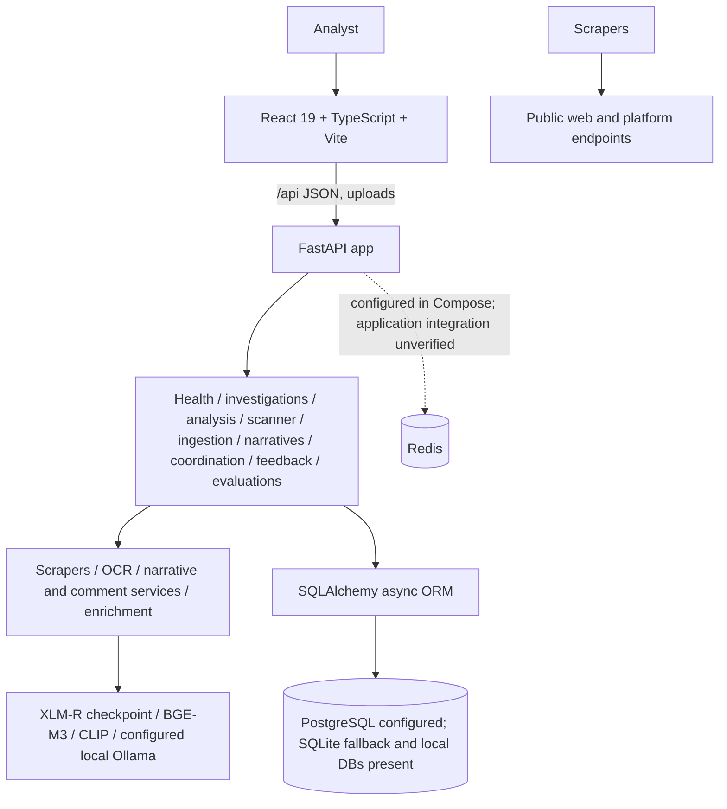

# Architecture

## System overview

The project is a single-page analyst application backed by a modular FastAPI service. The frontend is a React/TypeScript app built by Vite and uses React Router for page navigation, TanStack Query for remote state, and a shared fetch wrapper. Backend route modules handle investigations, analysis, ingestion/scanning, narratives, coordination, feedback, evaluations and health/model status. Service modules implement scraping, OCR and comment analysis. A model manager lazily loads configured Transformer models.

## Component interactions and API communication

`backend/app/main.py` initializes settings, attempts `Base.metadata.create_all`, configures CORS, registers exception handlers and mounts the aggregate API router under `/api`. The frontend `api.ts` uses `VITE_API_URL || '/api'`, sends JSON for object bodies and leaves multipart boundaries to the browser. API methods are asynchronous and use SQLAlchemy session dependencies. The UI calls analysis, investigation, scanner, evidence/narrative, feedback, model status and coordination endpoints through hooks or page components.

Compose advertises PostgreSQL, Redis, backend and frontend services. Its frontend variable is `VITE_API_BASE_URL`, which does not match the code’s `VITE_API_URL`; the frontend's Dockerfile and backend's Dockerfile were not present in the inspected tree. Treat container startup as unverified.

## Data flow

1. Analyst submits text, URL, source/thread, or media through a page.
2. FastAPI validates request schemas. URL ingestion uses URL safety checks and platform router/scrapers; uploaded files have extension/size validation and filenames are sanitized.
3. Text and extracted OCR text can be passed to model inference. Enrichment adds target-group, harm and severity attributes.
4. Results and source material can be stored in relational entities and returned to the SPA. Narrative and coordination endpoints derive analysis from investigation documents.
5. Human feedback records reviewer label and explanation against a classification/review task.

The above is the intended/code-supported flow; individual external source access and every UI workflow require runtime verification.

## Database design

SQLAlchemy models in `backend/app/db/models.py` use UUID primary keys, timestamps, JSON fields and explicit foreign keys. Main relationships:

- `Investigation` → `DataSource`, `Document`, `NarrativeCluster`, `EvidenceCitation`, `CoordinationIndicator`.
- `Document` → optional `DataSource`; `MediaAsset`; `ClassificationResult`; `NarrativeDocument`; `ReviewTask`.
- `MediaAsset` → `OCRResult` and optional classification association.
- `ClassificationResult` → `ReviewTask` and `HumanFeedback`.
- `NarrativeCluster` ↔ documents through `NarrativeDocument`.
- `Dataset` → `TrainingRun` and `EvaluationRun`; `TrainingRun` → evaluation runs.
- `AuditEvent` stores event/entity metadata and JSON details.

Database setup uses async SQLAlchemy. PostgreSQL URLs are assembled by settings; if initialization/connection fails, code switches to `sqlite+aiosqlite:///./narrativelens.db`. Tables are auto-created at startup. Alembic is installed/configured but there are no actual revision files beyond a placeholder, so schema evolution is not yet reproducible. README references pgvector/HNSW, but the inspected ORM does not declare a vector column or vector index.

## AI and external integrations

`ModelManager` supports lazy loading and device resolution for hate classification, embeddings and multimodal models. The local checkpoint directory contains XLM-R artifacts. Enrichment is explicit CPU rule logic. Scrapers cover web, Reddit, X/Twitter, YouTube and 4chan; optional keys/credentials are configured for YouTube/Reddit and Ollama is a local HTTP service. Exact availability depends on installed packages, credentials, network access and model files. Redis is in Compose but a production cache/task integration was not established in inspected routes/services.

## Authentication and security

No authentication or authorization flow was found. A `SECRET_KEY` exists as a setting but is not evidence of JWT/session security. CORS allows configured origins with credentials. URL validation resolves hostnames and blocks private/reserved addresses, but DNS resolution followed by a separate scraper request can be vulnerable to rebinding/redirect bypass unless the resolved address is revalidated at connection time. Upload checks include size and extension; provided MIME type is currently accepted even when disallowed (the branch is a no-op), and content signatures are not verified. Settings contain development defaults and should not be used as production secrets. API docs and broad CORS/method settings are enabled by default.
