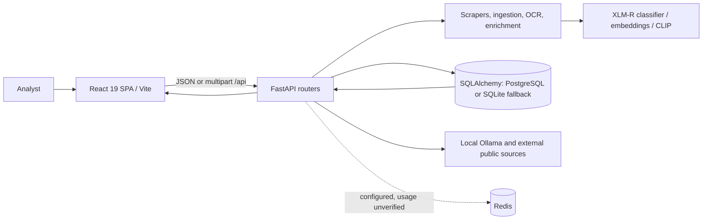

# Project Context — NarrativeLens AI

## Objective

NarrativeLens AI is a research and moderation workbench for collecting online text/media, classifying hate/offensive/neutral content, enriching results with target and harm labels, grouping narrative evidence, and supporting human review. Its appropriate use is analyst assistance; classifier results should not drive unchecked enforcement.

## Current implementation and stack

- **Backend:** Python (project metadata requires 3.11–<3.13), FastAPI, Pydantic Settings, SQLAlchemy async, Alembic, Uvicorn.
- **Frontend:** React 19, TypeScript, Vite 8, React Router, TanStack Query, Tailwind CSS, Recharts, Lucide.
- **Persistence:** SQLAlchemy models; SQLite async development fallback and PostgreSQL/asyncpg primary configuration. SQLite databases exist in the root and backend directories. Redis is described/configured in Compose but no application cache/queue path was verified in the inspected code.
- **ML:** PyTorch, Transformers, trained XLM-RoBERTa 3-class checkpoint; BGE-M3 embeddings and CLIP model management; regex/rule based target/harm/severity enrichment; EasyOCR and local Ollama support are present in selected services/configuration. Presence/configuration does not prove runtime use for every UI path.
- **Collection:** platform-specific scrapers for web, Reddit, X/Twitter, YouTube, and 4chan; OCR service; URL ingestion protections.
- **Tests:** Pytest backend tests plus manual scripts. No frontend test script/framework is configured.

## Architecture and data flow

The React SPA calls JSON and multipart endpoints through `frontend/src/lib/api.ts` (base `/api`, optionally `VITE_API_URL`). FastAPI mounts routers at `/api`. API handlers validate Pydantic inputs, call model, scraper, enrichment, and persistence services, then return JSON for React Query-driven screens. Investigations own sources/documents; documents can link media, OCR, classification, narrative-cluster membership, review and feedback records. Dataset, training, evaluation and audit models support research/admin workflows.

## Feature inventory

| Feature | Status | Implementation evidence / limitation |
|---|---|---|
| Investigation CRUD and document views | PARTIALLY COMPLETE | `backend/app/api/investigations.py`, `backend/app/db/models.py`, frontend investigation pages/hooks. Background run behavior requires live verification. |
| Text hate/offensive/neutral analysis | PARTIALLY COMPLETE | `backend/app/api/analysis.py`, `backend/app/ml/model_manager.py`, frontend text analysis. Local checkpoint and inference code exist; quality/runtime must be tested in target environment. |
| Target group, harm type, severity enrichment | PARTIALLY COMPLETE | `backend/app/ml/enrichment/`; heuristic implementations, not independently validated semantic models. |
| Image/meme analysis and OCR | PARTIALLY COMPLETE | Analysis API, `ocr_service.py`, model manager and Meme Analysis UI; pipeline availability varies by installed weights/device. |
| Universal URL/thread scanning | PARTIALLY COMPLETE | `api/scanner.py`, `services/scrapers/`; source access, platform blocks, and SSRF behavior need live verification. |
| Platform scrapers (web, Reddit, X, YouTube, 4chan) | PARTIALLY COMPLETE | `services/scrapers/`; credentials and platform behavior determine operation. |
| Narrative reporting/clustering | PARTIALLY COMPLETE | `api/narratives.py`, narrative scraper service and ORM tables. BGE embeddings exist, but persistent vector search/pgvector implementation was not confirmed; docs overstate it. |
| Coordination analysis | PARTIALLY COMPLETE | `api/coordination.py`, `app/coordination/detector.py`; real-world detection quality needs labeled validation. |
| Evidence/reports | PARTIALLY COMPLETE | narrative APIs, evidence UI; grounded RAG/counter-narrative generation is not established by inspected runtime implementation. |
| Human feedback/review | PARTIALLY COMPLETE | feedback/review APIs and models/UI. Authorization and identity are not implemented/verified. |
| Dataset/training/evaluation tools | PARTIALLY COMPLETE | ML scripts/checkpoints and evaluation APIs/UI; no end-to-end UI training pipeline verified. |
| Authentication and authorization | NOT IMPLEMENTED | No auth middleware, user model, token/session flow or route authorization found. |
| Frontend routing/layout/theme/error display | COMPLETE (code present) | `App.tsx`, `MainLayout.tsx`, context and shared components; visual/runtime behavior still requires browser verification. |
| Docker deployment | BROKEN / NEEDS VERIFICATION | Compose references Dockerfiles not present in source listing; environment mapping and image build may not work. |

## Development status

The working tree was clean at inspection. Latest recorded commit is `3633d09` (2026-10-28), a documentation citation update. Recent history includes scanner fixes and LLM configuration, followed by research report changes. Existing local model checkpoints and databases indicate substantial development, but do not by themselves confirm reproducible operation. TODO/FIXME markers were not detected in source search; ignored generated directories and data were excluded from that search.

## Highest priority next work

1. Remove insecure development defaults from production paths; implement authentication, authorization, rate limits and audit boundaries before exposing analyst/admin endpoints.
2. Reconcile Compose, Dockerfiles, env naming, database fallback, and actual frontend API base URL; validate reproducible startup.
3. Add schema migrations, integrity/index review, and explicitly choose supported database behavior (avoid silent production fallback to a different local database).
4. Exercise endpoint-to-UI flows and ML/OCR integrations, then document verified versus unavailable capabilities.
5. Add frontend tests and expand backend security/integration coverage; validate upload and URL ingestion against adversarial cases.
6. Align README/report claims (pgvector, Redis, Captum, Qwen generation, GPU EasyOCR) with runtime implementation and measured evidence.

## Caveat

The user-provided specification ended mid-item at “TECHNICAL_DOCUMENTATION.md — Fo”. Technical details are captured in `TECHNICAL_DOCUMENTATION.md`; any intended additional requirements after “Fo” could not be inferred.
