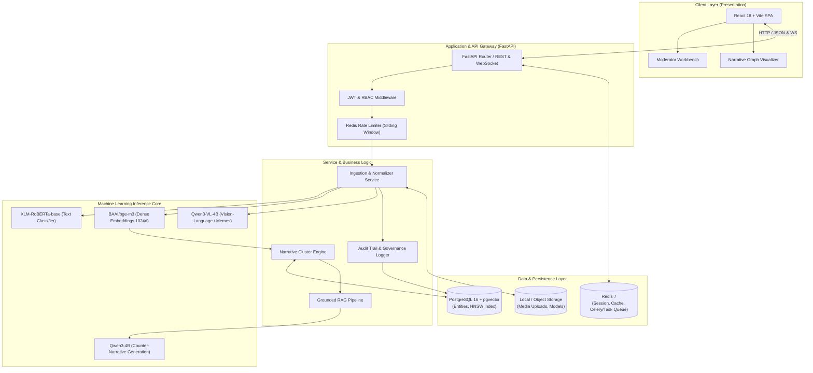
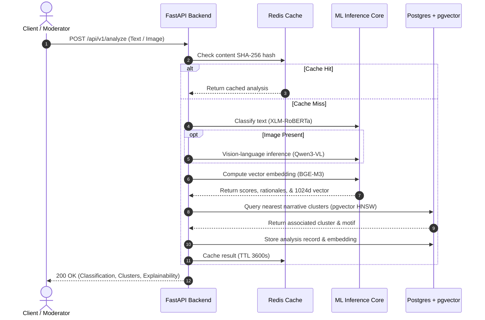
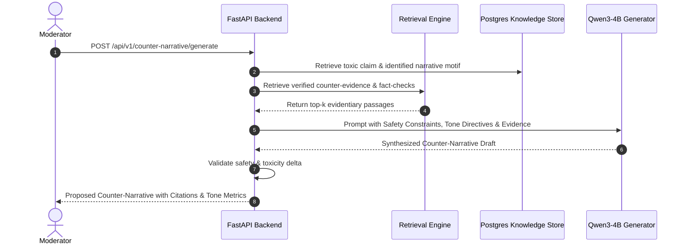

# NarrativeLens AI - System Architecture

## 1. Executive Overview

**NarrativeLens AI** is an enterprise-grade, research-ready platform designed for the detection, analysis, and mitigation of multilingual hate speech, toxic narratives, and coordinated disinformation campaigns. Unlike conventional binary classification systems that flag isolated toxic keywords, NarrativeLens analyzes semantic narrative clusters, reasons over multimodal content (memes and infographics), and synthesizes grounded, empathetic counter-narratives.

---

## 2. High-Level Architecture

The system is organized into decoupled layers: a Single Page Application (SPA) frontend, an asynchronous FastAPI backend service, an integrated Machine Learning inference engine, and a dual relational/vector storage substrate backed by PostgreSQL with `pgvector` and Redis.

---

## 3. Subsystem Breakdown

### 3.1. Frontend Single Page Application
* **Framework**: React 18 with TypeScript and Vite for rapid development and sub-second HMR.
* **Styling**: Tailwind CSS with custom theme variables for dark/light mode and accessible high-contrast moderation views.
* **State & Data Synchronization**: TanStack Query (React Query) for server state caching, optimistic updates, and background refetching; Zustand for client UI state.
* **Visualization Engine**:
  * D3.js / VisX for interactive force-directed graph views of narrative clusters.
  * Recharts for temporal toxicity volume, category distributions, and calibration curves.
* **Accessibility & Safety**: High-contrast mode, blurring overlays for graphic/offensive media by default, and single-click rationale inspection.

### 3.2. Application & API Gateway (FastAPI)
* **Framework**: FastAPI with Python 3.11+ asynchronous runtime (`asyncio`, `uvicorn`).
* **Validation & Schemas**: Pydantic v2 ensuring strict type validation and automatic OpenAPI documentation generation.
* **Authentication & Authorization**:
  * Stateless JWT authentication with bcrypt password hashing.
  * Role-Based Access Control (RBAC): `Admin`, `Moderator`, `Researcher`, and `Auditor`.
* **Rate Limiting & Protection**: Distributed sliding window rate limiting orchestrated via Redis (`limits` / custom Redis scripts).

### 3.3. Machine Learning Inference Engine
* **Execution Strategy**:
  * **Lazy Loading**: Models are dynamically mounted into GPU memory (CUDA) or CPU RAM on first call, preventing huge startup overhead during administrative tasks.
  * **Precision & Quantization**: Supports FP16, BF16, and 4-bit/8-bit quantization via BitsAndBytes for resource-constrained deployments.
  * **Device Fallback**: Seamless fallback across CUDA $\to$ ROCm $\to$ Apple MPS $\to$ CPU.
* **Primary Models**:
  1. **Text Classifier**: `FacebookAI/xlm-roberta-base` fine-tuned on multi-annotator datasets (HateXplain, HASOC) for multi-label toxicity and token-level attribution.
  2. **Dense Embeddings**: `BAAI/bge-m3` produces dense vector embeddings (1024 dimensions) supporting 100+ languages and long contexts (up to 8,192 tokens).
  3. **Multimodal Reasoning**: `Qwen/Qwen3-VL-4B-Instruct` parses complex visual memes, identifying hate symbols, caricature tropes, and semantic contradictions between image and caption.
  4. **Counter-Narrative Generation**: `Qwen/Qwen3-4B` fine-tuned and prompt-constrained for grounded, non-inflammatory de-escalation responses.

### 3.4. Relational & Vector Persistence
* **PostgreSQL 16**: Primary source of truth for accounts, moderation tickets, annotations, audit logs, and analysis runs.
* **pgvector Extension**:
  * Implements `vector(1024)` column types on content records.
  * Indexing via **HNSW (Hierarchical Navigable Small World)** with cosine distance operator (`<=>`) for millisecond-latency nearest-neighbor search.
  * Facilitates near-duplicate post detection and emergent narrative clustering without external standalone vector databases.
* **Redis 7**:
  * High-throughput caching for model prediction caching (keyed by content hash).
  * Session token revocation and sliding-window rate limit counters.
  * Message broker for background batch evaluation jobs.

---

## 4. End-to-End Data Flows

### 4.1. Real-Time Content Analysis Flow

### 4.2. Counter-Narrative Generation Flow

---

## 5. Security, Privacy & Governance Controls

1. **Personally Identifiable Information (PII) Redaction**: Preprocessing pipeline strips phone numbers, email addresses, and domestic identifiers before persistent storage or external logging.
2. **Auditability**: Every moderation action, manual override, or automated flag produces an immutable record in PostgreSQL with timestamp, user ID, and justification rationale.
3. **Model Safety Rails**: All generative counter-narrative outputs undergo post-generation toxicity filtering to ensure the system never amplifies harm or adopts abusive phrasing.
4. **Isolated Media Storage**: Uploaded media is sanitized, hashed, and stored under strict access controls to prevent hotlinking or unauthorized external exposure.
