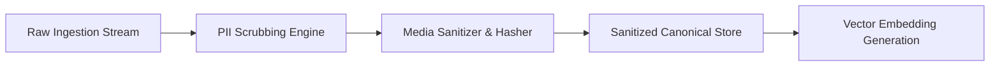

# NarrativeLens AI - Data Governance, Privacy & Ethical Protocol

## 1. Policy Purpose & Scope

The handling, processing, and storage of hate speech, toxic discourse, and extremist propaganda present profound ethical, legal, and psychological challenges. This Data Governance Policy establishes strict operational protocols for **NarrativeLens AI** to ensure data integrity, privacy compliance (GDPR, CCPA), annotator safety, and protection against misuse.

This policy applies to all project contributors, researchers, developers, machine learning practitioners, and deployment administrators.

---

## 2. Core Governance Principles

1. **Purpose Limitation**: Data containing hate speech or toxic discourse collected or processed by NarrativeLens AI must be utilized strictly for safety research, content moderation enhancement, and de-escalation modeling.
2. **Data Minimization**: Only the minimal necessary textual and visual attributes required to train or evaluate models are preserved. Ancillary metadata (e.g., follower graphs, user locations, profile biographies) must be stripped at ingestion.
3. **Anonymization by Default**: No persistent records may contain unmasked Personally Identifiable Information (PII).
4. **Security & Cryptographic Isolation**: Toxic corpora and model checkpoints must reside in encrypted storage with strict role-based access controls.
5. **Human Dignity & Harm Mitigation**: The rights and psychological welfare of affected target communities and human annotators take precedence over model training expediency.

---

## 3. Data Processing & PII Scrubbing Protocol

All ingested text and multimodal media must pass through the automated sanitization pipeline prior to vectorization or database commitment:

### 3.1. Automated Scrubbing Rules
* **Social Media Handles / Usernames**: Transformed to synthetic tokens (e.g., `@user_10482`).
* **Telephone Numbers & Email Addresses**: Regular expression matching replaces values with `[REDACTED_PHONE]` and `[REDACTED_EMAIL]`.
* **IP Addresses & Network Identifiers**: Stripped or replaced with loopback placeholders.
* **Geographical Precision**: Coordinates rounded to country-level or regional granularity; specific street addresses redacted.

---

## 4. Storage, Encryption & Access Control

1. **Encryption Standards**:
   * **Data at Rest**: All PostgreSQL tables, backups, and media volumes encrypted using AES-256.
   * **Data in Transit**: All API communication enforced over TLS 1.3 with modern cipher suites.
2. **Role-Based Access Control (RBAC)**:
   * **Viewer**: Read-only aggregated analytics and non-sensitive dashboards.
   * **Moderator**: Access to individual flagged items with UI content blurring active by default.
   * **Researcher**: Access to anonymized benchmarks, evaluation metrics, and model weights.
   * **Admin**: System configuration and audit log inspection.
3. **Audit Trails**:
   * Every access to raw toxic samples, export of datasets, or deletion of flagged content is permanently recorded in an append-only audit log containing actor ID, timestamp, action type, and reason.

---

## 5. Human Annotator & Moderator Safety Protocol

Reviewing abusive and graphic material carries documented risks of secondary trauma and psychological fatigue. NarrativeLens enforces strict annotator welfare standards:

1. **Informed Consent**: Annotators and evaluators must be clearly informed of the nature of the content prior to participation.
2. **Exposure Limits**:
   * Maximum continuous annotation session: **90 minutes**.
   * Mandatory minimum rest interval: **30 minutes**.
   * Maximum daily exposure limit: **4 hours**.
3. **Interface Protections**:
   * Graphic visual content is blurred by default; annotators must click to reveal.
   * Audio/video elements are muted by default.
4. **Immediate Escalation & Exit**:
   * Annotators may opt out of any task or category at any time without penalty.
   * Encounters with content involving child sexual exploitation or imminent physical violence must be escalated immediately according to statutory reporting guidelines.

---

## 6. Retention, Deletion & Right-to-be-Forgotten

* **Ephemeral Telemetry**: Real-time moderation request payloads are discarded from memory immediately after inference unless explicitly flagged for audit review.
* **Audit Retention**: Moderation ticket logs and system decisions are retained for **90 days** by default, after which they are automatically purged or aggregated into non-reversible metrics.
* **Data Subject Requests**: If an individual identifies their publicly scrubbed content in a research split and requests removal under GDPR Article 17 (Right to Erasure), the data engineering team will purge the corresponding sample from active and historical training splits within **30 days**.

---

## 7. Prohibited Uses & Non-Proliferation

NarrativeLens AI artifacts, code, and weights may **NOT** be used for:
* Generating hate speech, targeted harassment, or discriminatory propaganda.
* Mass surveillance of political dissent or suppression of legitimate civic discourse.
* Identifying or targeting marginalized groups for law enforcement harassment or deportation.
* Reverse-engineering bypass techniques for production content moderation filters.
